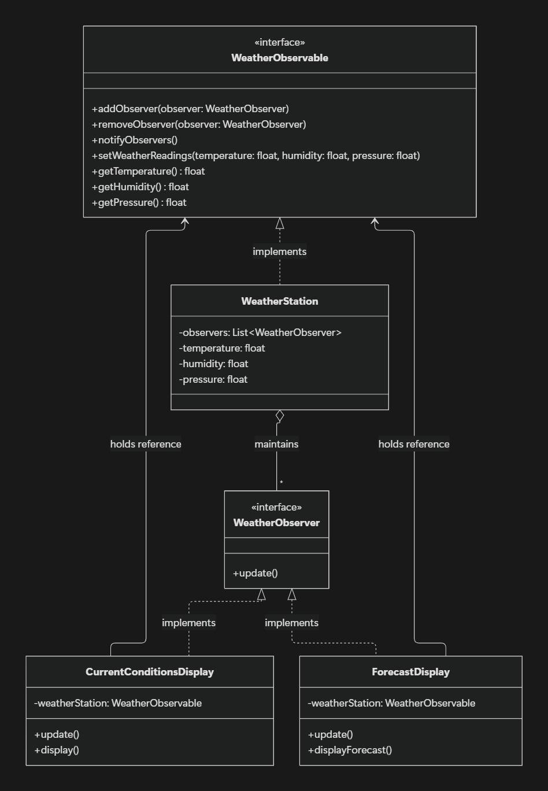

## Introduction

Imagine you are using a weather application on your mobile phone. The application displays the current temperature, humidity, and weather forecast.

Now, suppose the temperature changes. You want all the displays that depend on this information to update automatically.

How can we achieve this without making the weather station directly dependent on every display?

This is where the **Observer Design Pattern** comes in.

In this blog, we will understand the Observer Pattern, its structure, and its implementation in Java using a simple Weather Station example.

We will also understand why an observer can keep a reference to the observable instead of receiving the observable object as a parameter every time it is updated.

## 1. What Is the Observer Design Pattern?

The Observer Pattern is a behavioral design pattern in which one object, called the **Subject or Observable**, maintains a list of dependent objects called **Observers**.

Whenever the subject's state changes, it automatically notifies all registered observers.

Observers can also subscribe to or unsubscribe from the subject at runtime.

In simple terms:

**One object changes its state, and all interested objects get notified automatically.**

For example, a weather station maintains weather information. Different displays subscribe to the weather station and receive updates whenever the weather information changes.

## 2. Real-Life Examples

Here are some real-world examples of the Observer Pattern:

### Weather Applications

A weather station updates its temperature readings. Current-condition displays and forecast displays receive notifications and update their information.

### Social Media

When you follow someone on a social media platform, you become interested in their updates. When they publish new content, the platform can notify you.

### YouTube Subscriptions

When a subscribed channel publishes a new video, subscribers may receive notifications depending on their notification settings.

### Stock Market Applications

When a stock price changes, interested applications or users can receive updates about the new price.

These examples follow the same basic idea: **one source of information can notify multiple interested parties.**

## 3. Structure of the Observer Pattern

Let's understand the main components using our Weather Station example.

### 3.1 Observable Interface (Subject)

The Observable interface defines the methods needed to manage observers and notify them.

It generally contains methods such as:

- `addObserver()` – registers an observer.
- `removeObserver()` – removes an observer.
- `notifyObservers()` – notifies registered observers when the state changes.

In our example, this interface is called `WeatherObservable`.

### 3.2 Observer Interface

The Observer interface defines how an observer receives updates.

It contains an `update()` method that concrete observers implement.

In our example, the interface is called `WeatherObserver`.

### 3.3 Concrete Observable

The concrete observable implements the Observable interface.

It is responsible for:

- Maintaining the list of observers.
- Storing weather information.
- Updating the weather information.
- Notifying observers when the information changes.

In our example, `WeatherStation` is the concrete observable.

### 3.4 Concrete Observers

Concrete observers implement the Observer interface. Each observer can respond to a notification in its own way.

We will create two observers:

- `CurrentConditionsDisplay` – displays the current weather conditions.
- `ForecastDisplay` – analyzes weather readings to provide a forecast.

### 3.5 Client

The client creates the weather station and the displays. It can also update the weather readings to demonstrate how notifications work.

## 4. UML Class Diagram



The relationships between our classes are:

- `WeatherStation` implements `WeatherObservable`.
- `CurrentConditionsDisplay` and `ForecastDisplay` implement `WeatherObserver`.
- `WeatherStation` maintains a collection of observers.
- Each display holds a reference to the weather observable so it can retrieve the latest readings.

This design allows us to add new displays without changing the weather station's notification logic.

## 5. Implementation in Java

Let's implement the Observer Pattern step by step.

### Step 1: Create the WeatherObserver Interface

This interface defines the `update()` method that every observer must implement.

```
public interface WeatherObserver {
    void update();
}
```

Whenever the weather station notifies an observer, its `update()` method is called.

### Step 2: Create the WeatherObservable Interface

This interface defines how observers are registered, removed, and notified.

```
public interface WeatherObservable {

    void addObserver(WeatherObserver observer);

    void removeObserver(WeatherObserver observer);

    void notifyObservers();

    void setWeatherReadings(
        float temperature,
        float humidity,
        float pressure
    );

    float getTemperature();

    float getHumidity();

    float getPressure();
}
```

Notice that the interface exposes methods for accessing weather readings. Concrete observers can use these methods without depending directly on the `WeatherStation` class.

### Step 3: Create the WeatherStation Class

The `WeatherStation` class implements `WeatherObservable`.

It stores the weather readings and maintains a list of registered observers.

```
import java.util.ArrayList;
import java.util.List;

public class WeatherStation implements WeatherObservable {

    private final List<WeatherObserver> observers =
            new ArrayList<>();

    private float temperature;
    private float humidity;
    private float pressure;

    @Override
    public void addObserver(WeatherObserver observer) {
        observers.add(observer);
    }

    @Override
    public void removeObserver(WeatherObserver observer) {
        observers.remove(observer);
    }

    @Override
    public void notifyObservers() {
        for (WeatherObserver observer : observers) {
            observer.update();
        }
    }

    @Override
    public void setWeatherReadings(
            float temperature,
            float humidity,
            float pressure) {

        this.temperature = temperature;
        this.humidity = humidity;
        this.pressure = pressure;

        notifyObservers();
    }

    @Override
    public float getTemperature() {
        return temperature;
    }

    @Override
    public float getHumidity() {
        return humidity;
    }

    @Override
    public float getPressure() {
        return pressure;
    }
}
```

Let's understand the important part:

```
@Override
public void setWeatherReadings(
        float temperature,
        float humidity,
        float pressure) {

    this.temperature = temperature;
    this.humidity = humidity;
    this.pressure = pressure;

    notifyObservers();
}
```

When new readings arrive, the weather station updates its state and calls `notifyObservers()`.

The notification method loops through the registered observers and calls their `update()` methods.

The weather station does not need to know what each observer does with the information.

### Step 4: Create the CurrentConditionsDisplay Class

This observer displays the latest weather readings.

```
public class CurrentConditionsDisplay
        implements WeatherObserver {

    private final WeatherObservable weatherStation;

    public CurrentConditionsDisplay(
            WeatherObservable weatherStation) {

        this.weatherStation = weatherStation;

        weatherStation.addObserver(this);
    }

    @Override
    public void update() {
        display();
    }

    public void display() {
        System.out.println(
            "Current Conditions: " +
            "Temperature = " + weatherStation.getTemperature() +
            ", Humidity = " + weatherStation.getHumidity() +
            ", Pressure = " + weatherStation.getPressure()
        );
    }
}
```

Here are the two important lines:

```
private final WeatherObservable weatherStation;
```

And:

```
public CurrentConditionsDisplay(
        WeatherObservable weatherStation) {

    this.weatherStation = weatherStation;

    weatherStation.addObserver(this);
}
```

The display receives a reference to the observable through its constructor and registers itself as an observer.

We will discuss why this is useful in detail in the next section.

### Step 5: Create the ForecastDisplay Class

The forecast display also observes the weather station, but it can perform a different task when notified.

```
public class ForecastDisplay implements WeatherObserver {

    private final WeatherObservable weatherStation;

    public ForecastDisplay(WeatherObservable weatherStation) {
        this.weatherStation = weatherStation;
        weatherStation.addObserver(this);
    }

    @Override
    public void update() {
        displayForecast();
    }

    public void displayForecast() {
        System.out.println(
            "Analyzing weather readings: " +
            "Temperature = " + weatherStation.getTemperature() +
            ", Pressure = " + weatherStation.getPressure()
        );
    }
}
```

Both displays receive notifications through the same `update()` method, but each implements its own response.

Our example prints the latest readings for demonstration. A real forecast implementation would use weather data and forecasting logic to calculate the forecast.

### Step 6: Create the Main Class

Now let's create the weather station and register both displays.

```
public class Main {

    public static void main(String[] args) {

        WeatherStation weatherStation =
                new WeatherStation();

        CurrentConditionsDisplay currentDisplay =
                new CurrentConditionsDisplay(weatherStation);

        ForecastDisplay forecastDisplay =
                new ForecastDisplay(weatherStation);

        System.out.println("First weather update:");

        weatherStation.setWeatherReadings(30, 65, 1012);

        System.out.println("\nSecond weather update:");

        weatherStation.setWeatherReadings(32, 70, 1010);
    }
}
```

When `setWeatherReadings()` is called, both observers receive notifications.

Example output:

```
First weather update:
Current Conditions: Temperature = 30.0, Humidity = 65.0, Pressure = 1012.0
Analyzing weather readings: Temperature = 30.0, Pressure = 1012.0

Second weather update:
Current Conditions: Temperature = 32.0, Humidity = 70.0, Pressure = 1010.0
Analyzing weather readings: Temperature = 32.0, Pressure = 1010.0
```

The exact formatting depends on how the output strings are written.

Notice that we did not call either display's `update()` method directly from `Main`. The weather station handled the notifications.

## 6. Why Do We Pass WeatherObservable to the Observer's Constructor?

This is an important design decision.

Consider this code:

```
private final WeatherObservable weatherStation;

public CurrentConditionsDisplay(
        WeatherObservable weatherStation) {

    this.weatherStation = weatherStation;

    weatherStation.addObserver(this);
}
```

There are two things happening here:

1. The display stores a reference to the observable.
2. The display registers itself with the observable.

Let's understand why.

### Reason 1: The Observer Needs Access to the Latest Data

Suppose the weather station receives new readings:

```
weatherStation.setWeatherReadings(30, 65, 1012);
```

The station notifies all observers by calling:

```
observer.update();
```

The `update()` method does not receive any arguments.

So how does `CurrentConditionsDisplay` access the new temperature and humidity?

Because it already holds a reference to the weather station:

```
@Override
public void update() {
    display();
}
```

Inside `display()`, it can retrieve the latest readings:

```
weatherStation.getTemperature();
weatherStation.getHumidity();
weatherStation.getPressure();
```

The observer does not need the weather station to send the entire object every time a notification occurs.

It can retrieve the data whenever it needs it.

### Reason 2: We Avoid Unnecessary Type Checking

Imagine we passed an object to `update()`:

```
public void update(Object data) {

    if (data instanceof WeatherStation) {
        WeatherStation station = (WeatherStation) data;

        // Read weather data
    }
}
```

This introduces unnecessary type checking and casting.

It also makes the observer depend on the concrete `WeatherStation` class.

Now imagine we introduce another observable, such as `StockMarket`, or change the source of the weather data. We may need additional type checks or changes to the observer.

Instead, we use the interface:

```
private final WeatherObservable weatherStation;
```

The observer depends on the abstraction, not a particular implementation.

Any class that implements `WeatherObservable` can be supplied, provided it offers the required weather-reading methods.

This improves flexibility and reduces coupling.

**Important:** The problem is not passing an object to `update()` itself. The problem is using a generic `Object` and then checking its type with `instanceof` when we do not need to.

### Reason 3: We Can Register the Observer Automatically

The constructor also contains:

```
weatherStation.addObserver(this);
```

Here, `this` refers to the current `CurrentConditionsDisplay` object.

It means:

"Register this display with the weather station so it can receive future notifications."

When we create the object:

```
CurrentConditionsDisplay display =
        new CurrentConditionsDisplay(weatherStation);
```

the display registers itself automatically.

We do not need to call `addObserver()` separately in `Main`.

This is a convenient design choice, although registration can also be managed externally if the application needs more control over an observer's lifecycle.

## 7. Can We Pass Weather Data Directly to update() Instead?

Yes! This is a valid alternative.

There are two common ways to implement the Observer Pattern.

### Approach A: Pull Model

In the implementation we created, the observable notifies the observer without passing the data:

```
observer.update();
```

The observer then retrieves the latest readings from the observable.

```
@Override
public void update() {
    display();
}
```

This is commonly called the **Pull Model** because the observer pulls the information it needs.

Advantages:

- The notification method remains simple.
- The observer can retrieve only the data it needs.
- The observer can read the latest state whenever required.

Disadvantages:

- The observer needs a reference to the observable.
- It may make additional getter calls to retrieve data.

### Approach B: Push Model

In the Push Model, the observable sends the updated data directly to each observer.

First, create a data class:

```
public record WeatherData(
        float temperature,
        float humidity,
        float pressure) {
}
```

Then change the observer interface:

```
public interface WeatherObserver {
    void update(WeatherData data);
}
```

The weather station can notify its observers with the new readings:

```
@Override
public void notifyObservers() {

    WeatherData data = new WeatherData(
            temperature,
            humidity,
            pressure
    );

    for (WeatherObserver observer : observers) {
        observer.update(data);
    }
}
```

The display can receive the data directly:

```
public class CurrentConditionsDisplay
        implements WeatherObserver {

    @Override
    public void update(WeatherData data) {

        System.out.println(
            "Temperature: " + data.temperature() +
            ", Humidity: " + data.humidity() +
            ", Pressure: " + data.pressure()
        );
    }
}
```

With this approach, the display does not need to store a reference to `WeatherObservable` just to retrieve the weather readings.

The data is provided through a strongly typed `WeatherData` object, so no `instanceof` check is required.

Advantages:

- The observer receives the information it needs directly.
- It does not need to query the observable for each reading.
- The observer can be simpler when it only needs the notification data.

Disadvantages:

- The observable must decide which data to send.
- Observers receive the information provided in the notification, even if they need only part of it.
- The notification contract may need to change if new data must be included.

### Which Approach Should We Choose?

Both approaches are correct. The choice depends on the requirements.

If observers need to query the latest state or retrieve different pieces of information at different times, the Pull Model may be appropriate.

If the observable already knows exactly which updated information observers need, the Push Model can be simpler and more efficient.

In either approach, **we do not need `instanceof` when we design the interfaces and data types correctly.**

## 8. What Happens When an Observer Is Removed?

An observer can unsubscribe when it no longer needs updates.

For example:

```
weatherStation.removeObserver(currentDisplay);
```

After removal, the weather station will no longer notify `currentDisplay` through its observer list.

Other registered observers will continue receiving notifications.

This is useful when a display is closed, a user unsubscribes, or a component no longer needs the data.

## 9. Advantages of the Observer Pattern

- **Loose coupling:** The observable does not need to know the internal behavior of its observers.
- **Extensibility:** New observers can be added without changing the observable's notification logic.
- **Dynamic subscriptions:** Observers can be added and removed at runtime.
- **Separation of responsibilities:** The observable manages state and notifications, while observers handle their own responses.

## 10. Disadvantages of the Observer Pattern

- **Notification order:** The order in which observers are notified may matter, so it should be considered when designing the system.
- **Debugging complexity:** One state change can trigger several updates, making the flow harder to follow.
- **Performance:** Notifying a large number of observers can be expensive.
- **Lifecycle management:** If observers are not removed when they are no longer needed, the observable may retain references to them longer than intended.

## 11. When Should We Use the Observer Pattern?

Use the Observer Pattern when:

- Multiple objects need to react to changes in one object's state.
- You want to add or remove subscribers dynamically.
- You want to avoid tightly coupling the publisher to specific subscribers.
- Different components need to respond to the same event in different ways.

Examples include notification systems, event listeners, UI updates, monitoring systems, and stock-price updates.

## Conclusion

The Observer Pattern provides a clean way to notify multiple objects when a state changes.

In our Weather Station example, `WeatherStation` maintains a list of observers and notifies them whenever the weather readings change. Each observer responds in its own way.

We also learned why an observer may receive a `WeatherObservable` reference through its constructor: it allows the observer to retrieve the latest data without receiving the entire observable object in every notification.

However, passing a strongly typed `WeatherData` object directly to `update()` is also a good approach. The choice between the Pull Model and Push Model depends on how the application needs to share information.

The most important lesson is to **program to interfaces, keep components loosely coupled, and choose the notification model that fits your requirements.**
