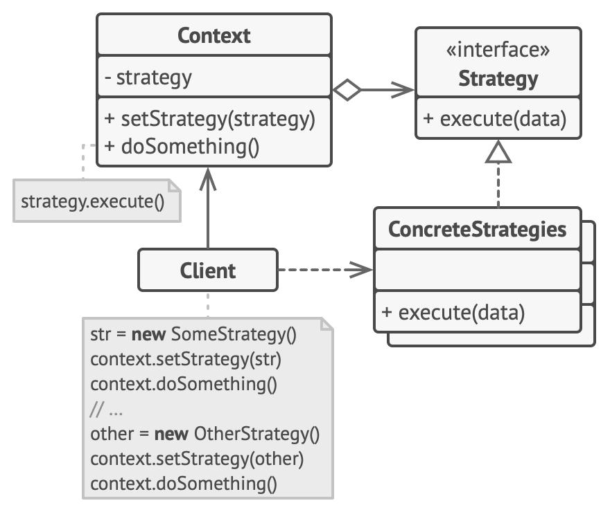
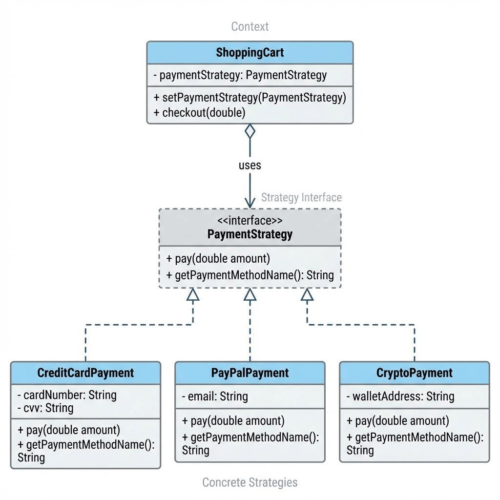
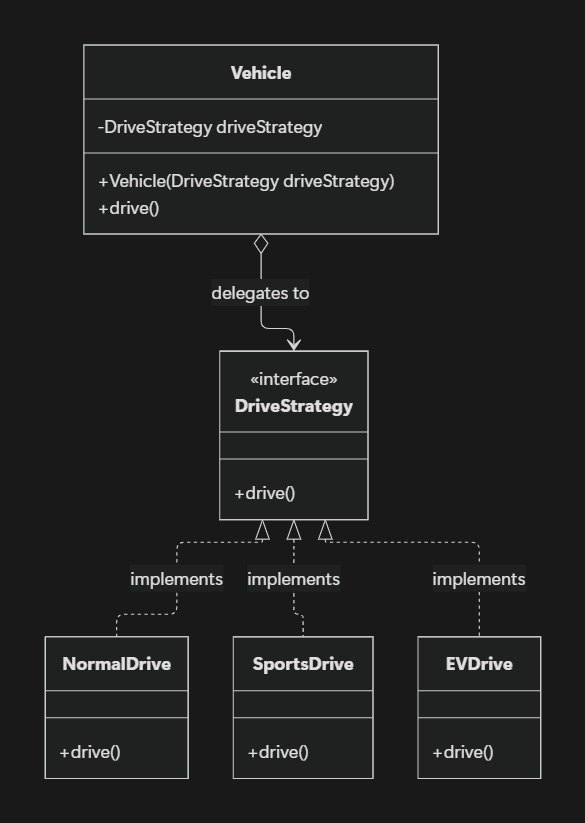
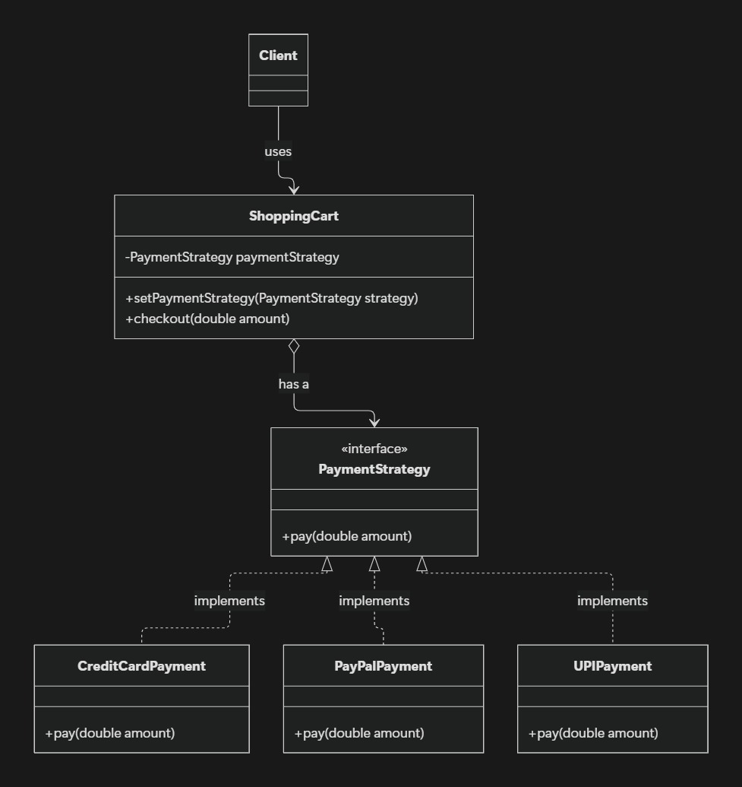

## 1. Introduction

Imagine building an e-commerce application that supports multiple payment methods, such as Credit Card, PayPal, and UPI.

One way to implement this is by using `if-else` or `switch` statements. However, as more payment methods are added, the code becomes harder to maintain.

The **Strategy Design Pattern** solves this problem by separating different behaviors into individual classes and allowing us to choose the required behavior at runtime.

## 2. What Is the Strategy Design Pattern?

The Strategy Pattern is a behavioral design pattern that defines a family of algorithms, encapsulates each one in a separate class, and makes them interchangeable.

In simple words, instead of putting all the logic in one class, we create separate classes for different behaviors and use the one we need.

### Real-Life Examples

- **Shopping Cart:** Credit Card, PayPal, UPI.
- **Courier Service:** Flat-rate, distance-based, or weight-based shipping costs.
- **Vehicles:** Normal, sports, or electric driving modes.

## 3. Problems Without the Strategy Pattern

Without this pattern, we may face several problems:

1. **Large conditional blocks:** Too many `if-else` or `switch` statements.
2. **Difficult maintenance:** Adding new behavior requires modifying existing code.
3. **Code duplication:** Similar logic may be repeated across classes.
4. **Tight coupling:** One class becomes responsible for multiple behaviors.
5. **Difficult testing:** Testing individual behaviors becomes harder.

The Strategy Pattern helps solve these problems by separating each behavior into its own class.

## 4. Structure of the Strategy Pattern

The pattern has three main components:

- **Strategy Interface:** Defines a common contract for all behaviors.
- **Concrete Strategies:** Implement different behaviors.
- **Context Class:** Maintains a strategy reference and delegates work to it.

The **Client** selects the required strategy and provides it to the context.





## 5. Implementation 1: Vehicle Driving Modes



Suppose different vehicles need different driving behaviors. Without the Strategy Pattern, we might override the `drive()` method in multiple vehicle classes, potentially duplicating code.

Let's solve this using the Strategy Pattern.

### Step 1: Create the Strategy Interface

```
public interface DriveStrategy {
    void drive();
}
```

### Step 2: Create Concrete Strategies

```
public class NormalDrive implements DriveStrategy {
    public void drive() {
        System.out.println("Driving: Normal");
    }
}
```

```
public class SportsDrive implements DriveStrategy {
    public void drive() {
        System.out.println("Driving: Sports");
    }
}
```

### Step 3: Create the Context Class

```
public class Vehicle {
    private final DriveStrategy driveStrategy;

    public Vehicle(DriveStrategy driveStrategy) {
        this.driveStrategy = driveStrategy;
    }

    public void drive() {
        driveStrategy.drive();
    }
}
```

### Step 4: Client Code

```
public class Demo {
    public static void main(String[] args) {
        Vehicle sportsVehicle =
            new Vehicle(new SportsDrive());

        Vehicle normalVehicle =
            new Vehicle(new NormalDrive());

        sportsVehicle.drive();
        normalVehicle.drive();
    }
}
```

**Output:**

```
Driving: Sports
Driving: Normal
```

Here, `Vehicle` delegates the driving behavior to the selected strategy instead of implementing it directly.

## 6. Implementation 2: Shopping Cart Payment Methods



Let's apply the same pattern to payment processing.

### Step 1: Create the Strategy Interface

```
public interface PaymentStrategy {
    void pay(double amount);
}
```

### Step 2: Create Concrete Strategies

```
public class CreditCardPayment
        implements PaymentStrategy {

    public void pay(double amount) {
        System.out.println(
            "Paid $" + amount + " using Credit Card"
        );
    }
}
```

```
public class UPIPayment implements PaymentStrategy {

    public void pay(double amount) {
        System.out.println(
            "Paid $" + amount + " using UPI"
        );
    }
}
```

### Step 3: Create the Context Class

```
public class ShoppingCart {
    private PaymentStrategy paymentStrategy;

    public void setPaymentStrategy(
            PaymentStrategy paymentStrategy) {
        this.paymentStrategy = paymentStrategy;
    }

    public void checkout(double amount) {
        if (paymentStrategy == null) {
            throw new IllegalStateException(
                "Select a payment method first"
            );
        }

        paymentStrategy.pay(amount);
    }
}
```

### Step 4: Client Code

```
public class Demo {
    public static void main(String[] args) {
        ShoppingCart cart = new ShoppingCart();

        cart.setPaymentStrategy(
            new CreditCardPayment()
        );
        cart.checkout(100);

        cart.setPaymentStrategy(
            new UPIPayment()
        );
        cart.checkout(200);
    }
}
```

**Output:**

```
Paid $100.0 using Credit Card
Paid $200.0 using UPI
```

The shopping cart can switch between payment methods without changing its internal implementation.

If we need to add PayPal or another payment method, we can create a new class implementing `PaymentStrategy` without modifying the existing payment strategies or the shopping cart.

## 7. Advantages of the Strategy Pattern

- **Easy to extend:** Add new strategies without modifying existing implementations.
- **Less code duplication:** Reuse common behaviors across different classes.
- **Loose coupling:** The context depends on an interface rather than concrete implementations.
- **Easy testing:** Test each strategy independently.
- **Runtime flexibility:** Change behavior when required.

## 8. When Should You Use It?

Use the Strategy Pattern when:

- A task has multiple possible implementations.
- Conditional statements are becoming difficult to manage.
- You need to switch behavior at runtime.
- Different classes need to reuse the same behavior.

Avoid introducing it for simple conditions where separate strategy classes would add unnecessary complexity.

## 9. Key Takeaways

Remember these three components:

- **Strategy:** Defines the common interface.
- **Concrete Strategy:** Implements a specific behavior.
- **Context:** Uses the selected strategy.

The main idea is to **separate what an object does from how it does it**.

## Conclusion

The Strategy Design Pattern helps us manage different behaviors by keeping each implementation in a separate class.

Whether we are selecting a payment method or a vehicle's driving mode, the context can delegate work to the required strategy without knowing its internal details.

Whenever you find a large `if-else` or `switch` statement managing different algorithms, consider whether the Strategy Pattern can make your code easier to maintain and extend.
